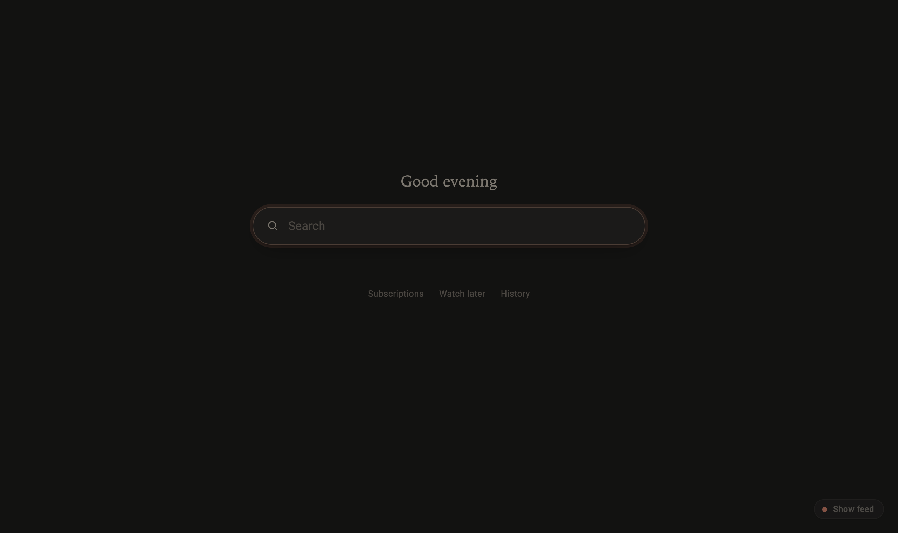
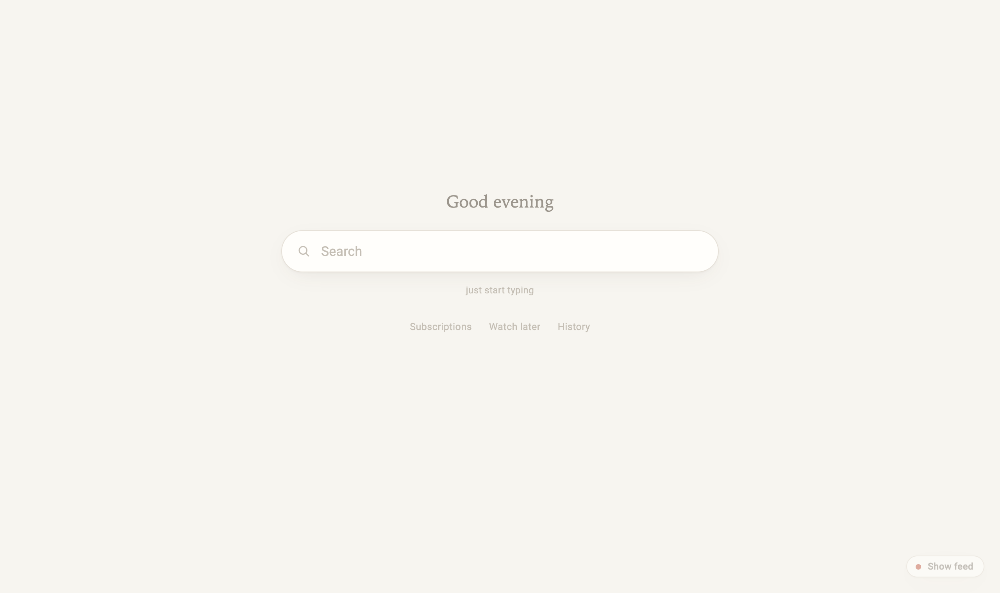
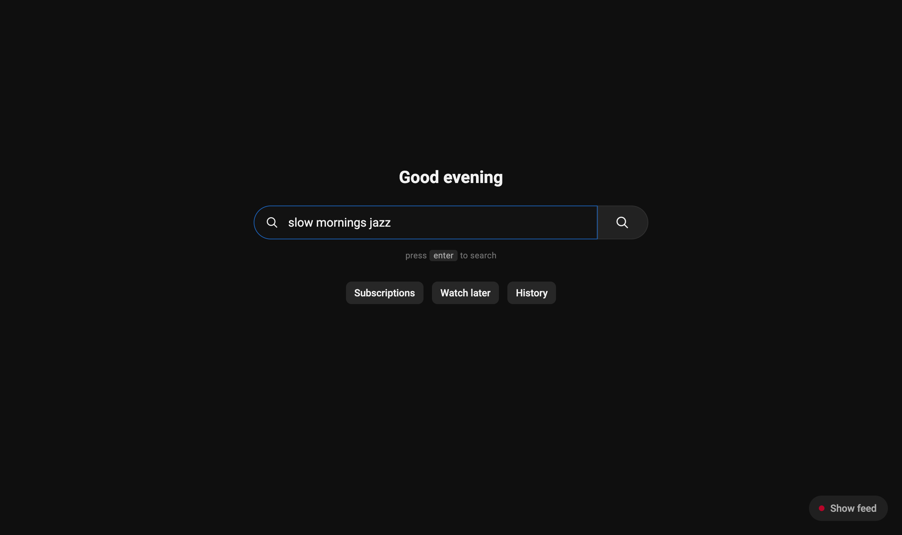
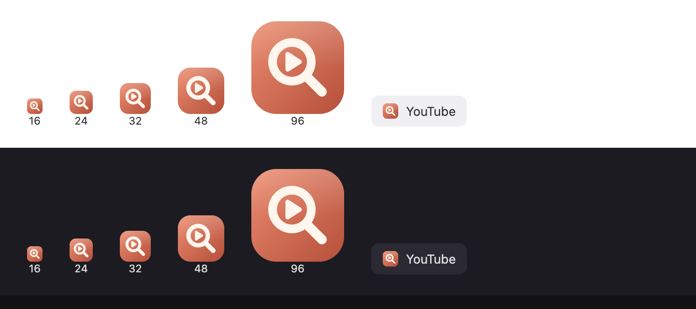

<p align="center">
  
</p>

<h1 align="center">Calm YouTube</h1>

<p align="center">
  A Firefox extension that swaps the YouTube home feed for one quiet search bar.<br>
  You go there to look something up, not to get pulled into whatever it decided to show you.
</p>



## What it does

- **No home feed.** Recommendations, Shorts shelves and the masthead ad are hidden before the first paint, and the grid is never rendered, so thumbnails and hover previews don't load either.
- **One search bar** with a short greeting. Start typing anywhere on the page (or press `/`) and the text goes into the box. `Enter` searches, `Esc` clears.
- **Three quiet links** under it: Subscriptions, Watch later, History. These are places you picked yourself.
- **A toggle in the bottom-right corner** (`Show feed` / `Calm mode`) puts the normal home page back. Your choice is remembered and stays in sync across tabs.
- **Toolbar button and `Alt+Shift+Y`** do the same toggle. Press either from any other page and you're taken to calm search.
- **A calm tab icon:** while calm mode is on, the tab's favicon turns into the extension icon.
- **Follows your theme**, matching YouTube's light or dark appearance. Respects `prefers-reduced-motion`.

Only the home page is changed. Search results, videos and channels stay exactly as they are.

| Light | Typing |
| --- | --- |
|  |  |

<p align="center"></p>

## Install

**[⬇ Install Calm YouTube for Firefox](https://github.com/aetherino/youtube-calm/releases/latest/download/calm-youtube.xpi)**

Open that link in Firefox, click **Allow** if Firefox asks about installing from this site, then click **Add**. The file is signed by Mozilla, so it stays installed after restarts.

### From source: temporary (lasts until Firefox restarts)

1. Open `about:debugging#/runtime/this-firefox`
2. Click **Load Temporary Add-on…** and pick `manifest.json` in this folder.

### From source: permanent

Regular Firefox only keeps add-ons that Mozilla has signed. Signing an **unlisted** add-on is free and automatic, and it stays private (it isn't published on addons.mozilla.org):

1. Create API credentials at <https://addons.mozilla.org/developers/addon/api/key/>
2. Run:
   ```bash
   AMO_JWT_ISSUER=user:123:456 AMO_JWT_SECRET=… ./scripts/sign.sh
   ```
3. Open the `.xpi` it prints in Firefox (**File → Open File…**) and click **Add**.

On Firefox Developer Edition or Nightly you can skip signing: set `xpinstall.signatures.required` to `false` in `about:config`, then install `web-ext-artifacts/calm-youtube.xpi` from `./scripts/build.sh`.

## Develop

```
manifest.json     MV2 manifest (content script at document_start, toolbar button, shortcut)
content.js        the overlay, toggle, favicon swap and SPA route tracking
calm.css          hides the feed + styles the overlay (light/dark tokens)
background.js     toolbar button / keyboard shortcut
icons/icon.svg    the icon
scripts/          build, sign, and the screenshot harness used for docs/
```

- `./scripts/build.sh` runs `web-ext lint` and packages the extension.
- `npx web-ext run` opens a throwaway Firefox profile with the extension loaded and reloads it whenever you edit a file.
- `scripts/screenshots.mjs` regenerates `docs/` by loading the content script into real YouTube through headless Chrome (needs `puppeteer-core`).

The on/off setting is stored in YouTube's own `localStorage` (`calmyt:enabled`). It can be read synchronously at `document_start`, which is what keeps the feed from flashing on screen before it's hidden.
